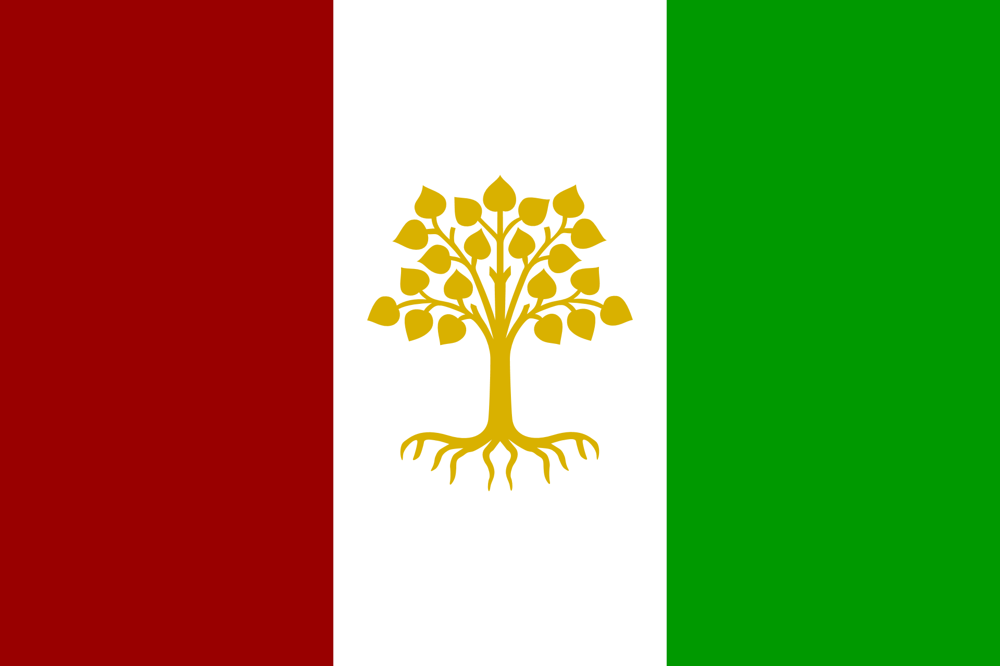

<p align="center">
  
</p>

# Middle Semitic · ܫܡܥ ܡܪܟܙ

**Middle Semitic** (ܫܡܥ ܡܪܟܙ, *šamâ markaz*) is a regional auxiliary language for the Middle East and North Africa: a blend of Hebrew and Arabic, written in Syriac, built from Proto-Semitic roots. It is one of fifteen planned **Universal Languages** (ULs), each designed to unite a region without displacing the native languages of its people.

This repository is the working archive of the language: the grammar, the phonology and script, a lexicon with one file per word, a page for every root, a comparative Swadesh list, and the standards that keep it all consistent. It is a collection of plain Markdown files written in [Obsidian](https://obsidian.md); read [How to read this repository](#how-to-read-this-repository) first if you are browsing on GitHub.

> ܦܒܕܐܬܐ ܐܝܠܗܐ ܒܪܐ ܗܠ ܣܡܝܡ ܘܗܠ ܐܪܨܐ
> *pibadâtâ êlhâ barâ hal samîm wa-hal arṣâ*
> "In the beginning God created the heavens and the earth." (Genesis 1:1)

|                        |                                                                                     |
| ---------------------- | ----------------------------------------------------------------------------------- |
| Native name            | ܫܡܥ ܡܪܟܙ (*šamâ markaz*)                                                            |
| Population in the zone | about 290 million                                                                   |
| Foundation             | Proto-Semitic                                                                       |
| Zone                   | the Semitisphere: the Middle East and North Africa                                  |
| Source languages       | the Arabic varieties, Israeli and Biblical Hebrew, Neo-Aramaic and Classical Syriac |
| Script                 | Syriac, written right to left                                                       |
| Word order             | SVO (VSO is archaic)                                                                |
| Morphology             | triconsonantal roots; productive derivation                                         |
| Alignment              | nominative–accusative                                                               |
| Author                 | Robert Marshall Murphy                                                              |

---

## Part I. The Universal Languages project

Middle Semitic belongs to a larger project, so its design choices make most sense against that background. This section sets out the project's case in full; the other fourteen languages live in the sister [Universal Languages repository](https://github.com/mrandmrsmurphy/universal-languages).

### The problem and the lessons

Many people have proposed "one language to unite the world". Esperanto came closest, and it had several things going for it: it was no one nation's language, and it belonged to nobody but its speakers. Its artificiality made it easy to learn, but that was also its downfall, because it is hard to regard it as a heart-language for anyone. Its scope was also too broad. French and Spanish and even English can be united, but the little sprinkles of German, Polish and Russian are too few and too unusual to make anyone happy. Meanwhile English is slowly stomping out many native tongues around the globe, and the alternative, backing off to insurmountable diversity, is no solution either.

Several people have already begun to do better. Interslavic and Interlingua have ISO codes. Folksprak is developing, Guosa is growing, and Ortatürk is computed from twenty-five Turkic languages. Targeted Universal Languages are burgeoning: rather than trying to be a one-world language or displace any native language, they are modest in design and practical in scope.

### Three goals

1. **Unify a people.** Every Universal Language unites a group that is either phylogenetically related or bound together as a sprachbund. Even if the goal is global oneness, it makes sense to start with regional oneness.
2. **Facilitate learning.** "Basic English" and "World English" are attempts to invite others in with less difficulty. A constructed language can be much easier to learn than a natural one, and, like learning Latin before Spanish, it lays the groundwork for learning a used language.
3. **Clarify identity.** If a region has a clearer identity, and people's identity within it is clear, they are better placed. Do you really understand German unless you know where it fits among the Germanic languages and peoples?

### What a UL is, and is not

Universal Languages are **regional auxiliary languages** designed to make communication easier, fairer and more natural for people in the same linguistic and cultural sphere. Each is a constructed bridge language that draws on the region's shared linguistic history and stays neutral, so that no single ethnic or national group dominates.

- They are **not meant to replace** indigenous languages. They are a linguistic roundtable, a common space where people from different backgrounds meet on equal footing.
- They **break down barriers**: people can communicate across their region without relying on a colonial or global superpower language.
- They are **easy to learn yet natural**: unlike Esperanto or Toki Pona, they feel familiar to their speakers while being simplified for use.
- They are **designed for practicality**: each has its own writing system, which prevents confusion, and adapts to modern needs without constant reform.
- They are **a hallway, not a home**: no one's native language, a shared space. You keep your mother tongue and gain a doorway to understanding your neighbours.

### The fifteen

| Language | Foundation | Population | Populous source languages |
| --- | --- | --- | --- |
| Dan'a'yo | Classical Chinese | 1.5 billion | Mandarin, Japanese, Korean, some Vietnamese |
| Neo-Sanskrit | Sanskrit | 1.4 billion | Hindustani, Punjabi, Gujarati, Bhojpuri, Marathi, etc. |
| Interlingua | Proto-Romance | 800 million | Spanish, French, Italian, Portuguese, Catalan, etc. |
| Folksprak | Proto-Germanic | 500 million | English, German, Dutch, Afrikaans, Swedish, etc. |
| Kintu | Proto-Bantu | 450 million | Swahili, Shona, Zulu, Xhosa, Kinyarwanda, Kirundi, etc. |
| Indo-Malay | Proto-Malayo-Polynesian | 380 million | Malay, Indonesian, Filipino, Javanese, etc. |
| Guosa | Proto-Niger-Congo | 340 million | Hausa, Mande, Yoruba, Igbo, etc. |
| Interslavic | Proto-Slavic | 300 million | Russian, Polish, Czech, Slovak, etc. |
| **Middle Semitic** | **Proto-Semitic** | **290 million** | **Arabic, Hebrew, Aramaic, Syriac, etc.** |
| MSEAL | Sprachbund | 233 million | Vietnamese, Thai, Khmer, Bengali, etc. |
| Dravindian | Proto-Dravidian | 230 million | Telugu, Tamil, Kannada, Malayalam, etc. |
| Zens | Proto-Iranian | 175 million | Persian, Pashto, Kurdish, Balochi, etc. |
| Ortatürk | Turkic (statistical average) | 170 million | Turkish, Azerbaijani, Turkmen, Kazakh, etc. |
| SEDES | Horn of Africa sprachbund | 117 million | Oromo, Amharic, Somali, Tigrinya, etc. |
| Balkan | Balkan sprachbund | 60 million | Greek, Ottoman Turkish, Albanian, Serbian, etc. |

The fifteen are assigned on linguistic geography, not politics. Finno-Ugric, Mongolian, Celtic, Amerindian, Australian aboriginal languages, the Caucasus, the Khoisan, two Baltic states and many other regions are left out of the schema. They can choose to join a UL group, but the return on a language area of under 50 million people is not worth the effort.

### How they would be adopted

1. Each UL is regionally intuitive and globally exotic: easy for locals, distinct from outsiders.
2. Adoption is gradual. People can write the UL however they like at first; within a century each UL gets its own unique script for clarity in business and diplomacy.
3. Each is regulated yet flexible: it evolves, but slowly, for stability.

Throughout nearly all of human history, people who learned to read and write did so in a language not their own. If every English speaker were bilingual, a verbal work would need translating into only fourteen other languages to reach 99% of all people; anyone who travelled much would be fluent in several ULs; and regionalism would return to the world.

### The end goal

To dethrone linguistic imperialism: no more English, Mandarin or French as the default global languages. Bantu speakers communicating without colonial leftovers; East Asians sharing one UL without relying on Mandarin; Europeans defaulting to Interlingua or Folksprak, not English. A world where understanding your neighbour's culture is easy and learning foreign languages is natural. Universal Languages are not just about words; they are about fairness, identity and human connection.

### The development scale

Each UL is scored on a ten-step scale of milestones; a language's score is the highest milestone **fully reached**. The phases overlap and can be started in any order.

| Score | Milestone | Done when |
| --- | --- | --- |
| 1 | Boundaries settled | Which lects are in the group and which are out is decided, with reasons |
| 2 | Phonology | The phoneme inventory and phonotactics are fixed from commonalities; an orthography exists |
| 3 | Morphology | Word classes, inflection and derivation are fixed |
| 4 | Syntax | Word order, alignment and clause structure are fixed; a complete reference grammar exists on paper |
| 5 | Core lexicon | The Swadesh 207 and Leipzig–Jakarta lists are filled with common and derivable forms |
| 6 | Sentences | The conlanger's 218 sentences are translated and the gaps they expose are fixed; first dialogues and texts |
| 7 | Working lexicon | About 1,000+ words; word-formation guidelines proven by use |
| 8 | Full lexicon | 3,000+ words, complete across its domains |
| 9 | Literature | Translation of important works is substantial |
| 10 | Teachable | Lessons exist; a new speaker can actually acquire the language |

A language graduates to its own repository when it outgrows incubation, by crossing into milestone 7 territory or by needing a richer format than the shared one supports. Middle Semitic did the latter: its lexicon needed per-tradition cognate properties (Ugaritic, Akkadian, Geʿez) that a shared archive could not carry.

---

## Part II. Middle Semitic

### The people and the problem

The Arabic varieties and the Israeli language could hardly be more similar, and yet no cultures are more at war with each other. Both are Central Semitic. Both have a diglossia, with a prestige form preserved in an ancient religious text and a common form used every day. Both have an array of contemporary dialects that are sometimes mutually unintelligible, a fact both language groups tend to deny. Neo-Aramaic, with Classical Syriac as its classical form, is the third source; its speakers are now few and divided into Western, Northern and Eastern varieties.

Middle Semitic takes that shared ground seriously. Its source languages are the Arabics (Maghrebi, Hassaniya, Egyptian, Levantine, Iraqi, Gulf, Hejazi, Najdi, Yemeni), Israeli and Biblical Hebrew, and Neo-Aramaic with Classical Syriac. Its zone is almost all of North Africa, the Arabian Peninsula and the Middle East.

### Design principles

These are the choices that recur across the pages. Each is implemented somewhere specific in the repository.

- **An equal vote.** Jews, Muslims and Christians get an equal vote, though most aspects are created logically and not derivationally. Whenever possible the many dialects of Arabic are consulted, as well as modern Israeli. See [Anthropology](Anthropology.md).
- **Re-derive from Proto-Semitic.** Words are re-derived from Proto-Semitic, through Proto-Central-Semitic, into a form the language can use. Where a root has diverged wildly in meaning over three thousand years, a modern word, even a borrowed one, is preferred to picking a side in a divergent bit of vocabulary. That can extend to the Maltese practice of taking an outside word and treating it as a triliteral root.
- **A neutral script.** Syriac, written right to left, is equally distant from the Arabic and the Hebrew scripts, with Neo-Aramaic as the middle ground. Vowels are diacritics; gemination uses the Arabic *shadda*. See [Orthography](Orthography.md).
- **Roots are productive.** Word formation relies on the triconsonantal root, so each root has its own page listing the words built on it. See [Roots](Roots/Roots.md).
- **Simple, predictable sounds.** 22 consonants and 5 vowels; only CV and CVC syllables, with no clusters; a marginal schwa in clitics and imperatives. Stress is predictable, counted over the whole word: a closed final syllable takes it, otherwise the penult. This is a compromise among Aramaic (penult), Hebrew (ultima) and Arabic (weight). See [Phonology](Phonology.md).
- **The *aw* → *ô* contraction is absolute.** No word contains an *aw* sequence, so even modern Arabic *ṭawīl* surfaces as *ṭôlâ*.
- **Clear morphology.** Verbs are cited in the 3rd masculine singular past; the passive is a long *û* after the first consonant; stative verbs have a long *î* as the second vowel (*ḥasîn*, non-past *yaḥsîn*), so they are identifiable in every form; nouns take regular and construct states, with no dual except for body parts and a few others. The construct is a frozen archaism, kept because all ancient texts use it. See [Morphophonology](Morphophonology.md).
- **Gender by majority.** For plain *-a* nouns, gender follows the majority of the Hebrew, Arabic and Aramaic cognates. A noun without a *-t* in its spelling that is feminine in the cognates is "crypto-feminine".
- **SVO, without case.** Word order carries the grammar and is strictly enforced (VSO is the deliberately archaic form); pro-drop is common because verbs inflect for person. Copulas are split into existence particles (*hô*, *yiš*) and an equality verb (*kôn*). See [Morphosyntax](Morphosyntax.md).
- **Eight small prepositions that conjugate.** *li-*, *bi-*, *pi-*, *ki-*, *min*, *ʿal-*, *ʿim* and *bên* take pronominal suffixes ("upon me", *ʿalnî*); every other "preposition" is a noun in the construct state. Six of them have clitic forms that may reduce to a schwa in fast speech. See [Prepositions](Prepositions.md).
- **We make our own data.** The [lexicon](Lexicon/) is the source record. There is no external dictionary to defer to; cognate evidence is gathered per word and recorded with its strength.

### Status

By the scale above, Middle Semitic has a complete grammar (milestone 4) and is working on milestone 5, the core lexicon. As of this writing the lexicon has about 470 entries, there are about 280 root pages, and just over half of the 207 Swadesh cells are filled. Exact counts are kept in [`AIOS/facts.yaml`](AIOS/facts.yaml). Open items include the remaining Swadesh cells (mostly basic verbs and adjectives), the conlanger's 218 sentences, and checking the Aramaic cognates against a Syriac grammar.

### What is in this repository

| Page | What it is |
| --- | --- |
| [Middle Semitic](Middle%20Semitic.md) | The hub, with the summary table |
| [Design Philosophy](Design%20Philosophy.md) | The principles behind the design choices, each with its reason |
| [Anthropology](Anthropology.md) | The languages and peoples involved, the sources, the consonant correspondences, the rationale for choices |
| [Phonology](Phonology.md) | Consonants, vowels, phonotactics, stress |
| [Orthography](Orthography.md) | The Syriac-script writing system |
| [Morphophonology](Morphophonology.md) | Noun and verb morphology and the sound changes within them |
| [Morphosyntax](Morphosyntax.md) | Word order, the copula, the conjugating prepositions, subordination |
| [Prepositions](Prepositions.md) | The eight small prepositions and their contrasts |
| [Swadesh](Swadesh.md) | The 207-item comparative list across Arabic, Hebrew, Syriac and the dialects, with the Middle Semitic form |
| [Dialogue](Dialogue.md) | Sample conversations and texts, such as the Shahada |
| [Torah](Torah.md) | The Five Books word by word: Hebrew, an Arabic cognate, the Peshitta and Middle Semitic |
| [`Lexicon/`](Lexicon/) | One file per word (about 470), each with a table and queryable cognate properties |
| [`Roots/`](Roots/) | One file per root, listing the words built on it |
| [`AIOS/`](AIOS/) | Maintainer and agent material: conventions, rulings, build scripts, machine-readable facts |
| [`logs/`](logs/log.md) | The append-only session log: what was decided and when |

### How to read this repository

The pages are Obsidian notes, so GitHub shows some of their syntax raw:

- `[[Phonology]]` is a link to the page called Phonology. On GitHub it appears as literal brackets; open the file by name in the file list.
- `![[Semitic_Flag.png]]` embeds an image from `images/`.
- Files in `Lexicon/` are named by the unvocalized Syriac spelling of the word (for example [ܡܠܟܐ.md](Lexicon/%DC%A1%DC%A0%DC%9F%DC%90.md), "king"). A second word with the same spelling takes a numeric suffix (`ܒܢܝ.md` *banê* "he built", `ܒܢܝ 2.md` *binî* "on me").
- `Lexicon/Words - all.base` is an Obsidian *Base*: a live table of every entry. GitHub shows only its configuration. Open the repository as an Obsidian vault to see the table.

For the best experience, clone the repository and open the folder as a vault in Obsidian.

### The lexicon

Each entry has a visible table (romanization, root, part of speech, gloss, cognates, notes) and, mirroring it, YAML properties that tools can query:

```yaml
root: ܡ-ܠ-ܟ
pos: noun
gender: masculine
gloss: king
hebrew: מֶלֶךְ
arabic: مَلِك
aramaic: ܡܰܠܟܴ݁ܐ
ugaritic: mlk
proto-semitic: "*malk-"
```

- Every tradition gets its own lowercase property, so cognates beyond Hebrew, Arabic and Aramaic (Ugaritic, Akkadian, Geʿez…) can be recorded when there is evidence.
- **A missing property means "not checked". A value of `none` means "checked and confirmed absent".** `none` is never written without an actual search.
- Where the cognate's meaning differs, or the form is only a functional match, a note says so. Where a form is not attested (the small Ugaritic corpus, for example) but is supplied to complete a paradigm, the entry says: "No known examples of the Ugaritic form exist; it is based on supposition."
- Inflected prepositions are entries of their own (*ʿalnî* "upon me"), so each has its own cognate paradigm values.

The full entry format is documented in [`AIOS/memory/project_middle_semitic_lexicon_entry_format.md`](AIOS/memory/project_middle_semitic_lexicon_entry_format.md).

### For maintainers and agents

`AIOS/` holds the vault's working memory: the conventions, the rulings on grammar, a to-do list, and the build scripts that generate paradigms and keep the YAML in sync with the tables. [`CLAUDE.md`](CLAUDE.md) and [`AGENTS.md`](AGENTS.md) (kept identical) tell an AI assistant how to work here. Content pages describe the current state only; history lives in [`logs/log.md`](logs/log.md).

---

## Licence

The text and data in this repository are licensed under [Creative Commons Attribution–ShareAlike 4.0 International](https://creativecommons.org/licenses/by-sa/4.0/) (CC BY-SA 4.0): you may share and adapt them, with credit, under the same terms.

## Contributing

Outside contributions are welcome. All of them are reviewed before they are merged, and contributors who have shown care can be given direct access. See [CONTRIBUTING](CONTRIBUTING.md).

## Credits

Designed and written by Robert Marshall Murphy, with the help of several AI assistants (Claude, Kimi, Cursor, ChatGPT, Z and others) for lexicon coverage, cognate research and documentation. Cognate evidence draws on Wiktionary, the ORACC Ugaritic glossary, and the standard grammars of Ugaritic and Syriac. The Syriac text of the Torah page comes from the Peshitta, checked against [peshitta.eu](https://www.peshitta.eu) and the [ETCBC](https://github.com/ETCBC/peshitta) edition.
